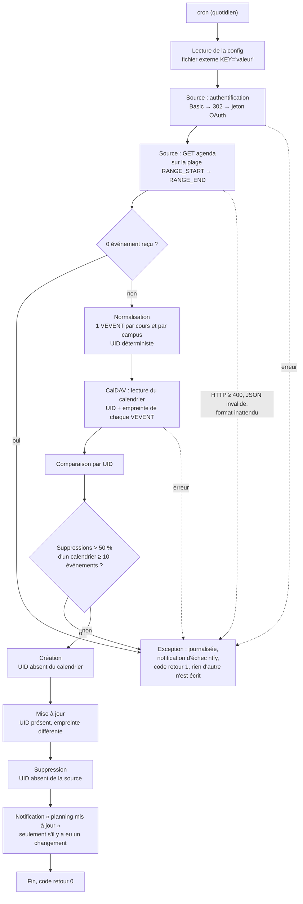

# agenda-sync

Script Python qui recopie un planning, récupéré depuis une API REST, dans un calendrier CalDAV auto-hébergé. Il crée, met à jour et supprime les événements pour que le calendrier reflète exactement la source, et notifie les échecs par push (ntfy).

La partie propre à la source est isolée dans [`source.py`](source.py). La version fournie cible une API de planning scolaire avec authentification OAuth implicite. Pour une autre source, il suffit d'y écrire une classe qui renvoie des événements normalisés (le format est décrit en tête du fichier). Le reste, dans [`agenda_sync.py`](agenda_sync.py), est générique : comparaison, écriture CalDAV, garde-fous et notifications.

## Flux



## Rapprochement des événements

Chaque événement de la source reçoit un UID déterministe, calculé à partir de son identifiant chez la source et de son campus : `Class_<id>_<campus>@<UID_DOMAIN>`, ou `Class_<id>@<UID_DOMAIN>` s'il n'a pas de salle. Le même cours obtient donc le même UID à chaque exécution, et c'est par cet UID que l'événement distant est associé à l'événement local. Un cours réparti sur deux campus produit deux événements, un par campus.

À chaque événement est attachée une empreinte SHA-256 du contenu métier : intitulé, type, enseignant, modalité, commentaire, classe, campus, salles, horaires, coordonnées et délai de rappel. Elle est stockée dans le VEVENT, dans une propriété `X-SYNC-HASH`.

| Situation | Action |
|---|---|
| UID présent à la source, absent du calendrier | création |
| UID présent des deux côtés, empreinte différente | mise à jour (VEVENT réécrit en entier) |
| UID présent des deux côtés, même empreinte | rien |
| UID présent dans le calendrier, absent de la source | suppression |

Comme le délai de rappel entre dans l'empreinte, modifier `ALARM_BY_TYPE` met à jour tous les événements concernés à l'exécution suivante. Les examens et soutenances ont un rappel 24 h avant et un préfixe `[EXAM]` ou `[SOUT]` dans le titre ; les autres événements, un rappel 30 min avant.

Le calendrier de destination doit être dédié au script : tout événement qu'il contient sans figurer à la source est supprimé (voir [LIMITES.md](LIMITES.md)).

## Garde-fous

**Réponse vide.** Si l'API renvoie zéro événement, le script s'arrête avant de lire le calendrier. Une panne de la source ou une session expirée qui renverrait une liste vide ne vide donc pas le calendrier.

**Suppression de masse.** Si le calendrier contient au moins 10 événements et que la comparaison demande d'en supprimer plus de la moitié, le script abandonne sans rien écrire. Les deux seuils sont réglables (`MIN_EVENTS_FOR_GUARD`, `MAX_DELETE_RATIO`).

**Réponse malformée.** Un code HTTP d'erreur (`raise_for_status`), un JSON illisible ou l'absence de la clé `result` lèvent une exception avant toute écriture. Les entrées qui ne sont pas des objets sont écartées, et celles auxquelles il manque l'identifiant ou les horaires sont ignorées avec un avertissement.

**Jetons.** Le script ne conserve aucun jeton : il s'authentifie à chaque exécution avec l'identifiant et le mot de passe du fichier de configuration, et utilise le jeton obtenu pour la seule requête qui suit. Il ne gère donc pas d'expiration ni de rafraîchissement. Si l'authentification est refusée (autre réponse qu'une redirection 302), ou si le jeton manque dans la redirection, l'exécution échoue proprement.

**Erreur serveur.** Toute erreur, côté source ou côté CalDAV, arrête l'exécution, est journalisée avec sa trace et déclenche une notification d'échec. Il n'y a pas de nouvel essai dans la même exécution : c'est le cron suivant qui retente. Une erreur pendant les écritures peut laisser une synchronisation partielle, que la passe suivante complète, puisque la comparaison repart de l'état réel du calendrier.

**Mode simulation.** `--dry-run` fait tout le parcours (authentification, lecture, comparaison, garde-fous) et affiche les créations, mises à jour et suppressions prévues, sans rien écrire dans le calendrier ni dans le fichier journal. Les notifications de changement sont désactivées ; une notification d'échec est quand même envoyée si l'exécution échoue.

## Installation et planification

Prérequis : Python 3 (TODO : version minimale non vérifiée), un serveur CalDAV (testé avec Nextcloud), un serveur ntfy avec un jeton d'accès.

```bash
sudo mkdir -p /opt/agenda-sync/logs
sudo cp agenda_sync.py source.py requirements.txt /opt/agenda-sync/
python3 -m venv /opt/agenda-sync/venv
/opt/agenda-sync/venv/bin/pip install -r /opt/agenda-sync/requirements.txt

# Configuration : à partir du modèle, hors du dépôt, lisible par le seul propriétaire
cp .env.example /opt/agenda-sync/agenda-sync-creds
chmod 600 /opt/agenda-sync/agenda-sync-creds
# puis remplacer chaque CHANGE_ME

# Premier passage à blanc
/opt/agenda-sync/venv/bin/python /opt/agenda-sync/agenda_sync.py --dry-run
```

Le calendrier `CALENDAR_NAME` doit exister avant le premier passage et ne servir qu'au script. Côté Nextcloud, utiliser un mot de passe d'application plutôt que le mot de passe du compte.

Planification, une fois par jour :

```cron
15 7 * * * /opt/agenda-sync/venv/bin/python /opt/agenda-sync/agenda_sync.py > /dev/null 2>&1
```

La sortie standard est jetée : le suivi passe par le journal (`LOG_FILE`, rotation à 500 Ko, 3 fichiers) et par les notifications ntfy.
